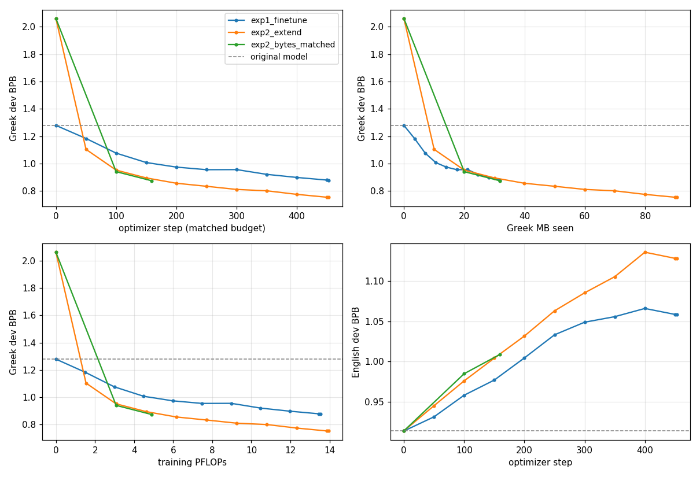
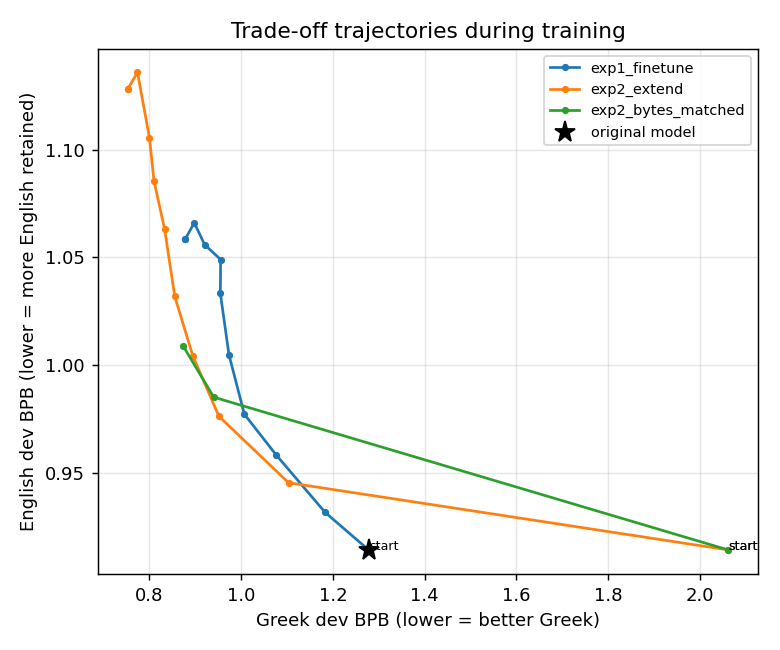

# Vocabulary expansion vs. fine-tuning: SmolLM2-135M → Greek

**Bottom line.** At the brief's matched budget (453 steps, 14.8M tokens, ≤30 min per arm on a free
Colab T4), adding 8,000 Greek tokens (Exp2) beats plain continued training (Exp1) on Greek: 0.751 vs
0.874 bits per byte (BPB), −14%. It is worse on English: 1.201 vs 1.117 (+7.6%). Exp2 buys **0.122 BPB of
extra Greek for 0.084 BPB of extra English loss**. Most of that extra loss reflects how far Exp2 gets in
the same budget, not a worse trade-off:
- Each Exp2 token carries 2.8× more Greek text. Stopped at Exp1's amount of Greek, Exp2 matches Exp1's
  Greek with about a third of the compute and loses 0.044 BPB *less* English.
- During training, at every Greek level below ~1.1 BPB, Exp2 had given up less English than Exp1 (Fig. 2).

## 1. What was done
- **Data.** 150 MB of cleaned Greek, half Wikipedia-el and half FineWeb-2. It is more than ~100 MB
  because Exp2 reads 2.8× more text per token; both arms stay under one epoch (0.21, 0.60).
- **Arms.** Both train all weights with the same document order, AdamW, and a WSD schedule peaking at
  3e-4. Exp2's 8,000 new rows get 10× that rate and no weight decay. fp16 + GradScaler, 0 skipped steps.
- **Budget.** Calibrated once on the slower arm (Exp2) and locked in `budget.json`. Exp2 uses 3% more
  FLOPs for its larger output layer (Table 1).
- **Supplementary run, outside the matched budget.** Exp2 from step 0, stopped at Exp1's 31.8 MB of
  Greek (159 steps). Its own WSD schedule ends annealed. It separates "better tokenizer" from "more
  Greek per step".

## 2. How the existing vocabulary is modified
**Continued BPE, append-only.** Greek training text (60 MB) is segmented with SmolLM2's pre-tokenizer and
all 48,900 of its merges. New merges are learned *on top of* that segmentation and accepted only if they
form a new all-Greek string (first: ` και`, ` της`, ` του`). The 8,000 merges are appended at the lowest
priority, as ids 49,152–57,151 (57,152 = 893×64). Nothing is removed or renumbered and every new token is
reachable. By contrast, a separately trained Greek BPE would leave 5–17% unreachable, because SmolLM2
already merges the space with the UTF-8 lead byte.

**English tokenization is unchanged by construction.** Original merges fire first and new ones match
only Greek bytes. QA confirmed no change in 3,761 English test chunks or 502 random non-Greek strings.
The *model's* English still changes (§4).

**Compression.** Held-out Greek goes from 2.14 to 6.20 bytes per token (2.9×) and from 5.57 to 1.93 tokens
per word. 99.1% of new tokens occur in held-out text; in training the median new token was seen 538
times, and 3 never.

**Initialisation.** Embeddings are tied. Each new row is the **mean of its original sub-tokens'
embeddings**, so it lies among the existing rows. At step 0, English moves +0.0002 BPB (0.07% of English
probability on new tokens), while Greek is 0.75 BPB worse until the new rows train.

## 3. Evaluation design
- **Metric.** BPB on identical text for every model; per-token perplexity is not comparable across
  tokenizers. Chunks are ≤1,000 characters and fit one window of the *original* tokenizer, so Exp2
  sees no extra context.
- **Test sets.** 500 documents each, drawn *before* the training pool. Training documents sharing a
  paragraph or MinHash near-duplicating any of them were removed (325).
  - Greek (4.2 MB): Wikipedia, the FineWeb-2 test split, Belebele.
  - English (2.9 MB): FineWeb-Edu (SmolLM2's own data), BBC News 2025 (after the model), Belebele.
- **Dev sets.** 150 documents each of Wikipedia-el, FineWeb-2-el and FineWeb-Edu-en; they drive the figures.
- **Statistics.** Paired document bootstrap, 95% CIs over evaluation noise only.
- **Diagnostics.** English mass on new tokens and English BPB renormalised over the original vocabulary;
  cloze tasks (HellaSwag/ARC-Easy in both languages, PIQA) and greedy generation.

## 4. Results
*Table 1. Test BPB, macro over 3 sets per language; lower is better.*

| model | steps / tokens | Greek read | compute | **Greek** (Δ base) | **English** (Δ base) |
|---|---|---|---|---|---|
| original SmolLM2-135M | – | – | – | 1.285 | 0.964 |
| Exp2 at step 0 | 0 | – | – | 2.034 (+0.749) | 0.965 (+0.000) |
| **Exp1** fine-tune | 453 / 14.8M | 31.8 MB | 13.6 PFLOPs | **0.874** (−0.412) | **1.117** (+0.152) |
| **Exp2** +8k tokens | 453 / 14.8M | 90.5 MB | 14.0 PFLOPs | **0.751** (−0.534) | **1.201** (+0.237) |
| Exp2 at Exp1's Greek bytes (suppl.) | 159 / 5.2M | 31.8 MB | 4.9 PFLOPs | 0.865 (−0.420) | 1.073 (+0.109) |

*Table 2. Exp2 vs Exp1, paired 95% CIs. Gain = Exp1 − Exp2 on Greek; cost = Exp2 − Exp1 on English.*

| Exp2 vs Exp1 | extra Greek gain | extra English cost |
|---|---|---|
| matched tokens and steps | **+0.122** [0.121, 0.124] | **+0.084** [0.083, 0.086] |
| matched Greek bytes (suppl.) | +0.009 [0.007, 0.011] | **−0.044** [−0.045, −0.043] |

Every effect has the same sign on all three sets of its language, including out-of-domain Belebele
(Greek gains 0.129/0.114/0.125). Details: [`results.md`](../results/t4_run/results/combined/results.md).

*Figure 1. Dev BPB. Blue Exp1, orange Exp2, green supplementary, dashed original. Greek vs steps, Greek
MB read and FLOPs; English vs steps.*

*Figure 2. Greek vs English dev BPB every 50 training steps; lower-left is better.*

**Reading the trade-off.**
1. **Speed.** Exp2 repays its 0.75 BPB step-0 deficit within 50 steps. Per step it learns Greek faster
   and forgets English faster. Per Greek byte, both arms learn Greek at nearly the same rate (Fig. 1b);
   the 0.009 gap at matched bytes is effectively zero.
2. **Forgetting** depends on both the number of updates and how far each one moves the weights. Matched
   steps with 2.8× the text raise English loss by 55%; matched text with 2.85× the steps, by 40%.
   One seed cannot separate the two.
3. **Trade-off.** Where the two paths overlap, Exp2's is better (Fig. 2). At Exp1's final Greek, Exp2 had
   ~0.04 BPB less English loss, confirmed on test by the annealed supplementary run (−0.044). At Exp1's
   final English, Exp2 was ~0.04 better on Greek. Mid-run points are un-annealed, so this understates
   Exp2. Weight-interpolation frontiers ([plot](../results/t4_run/results/interpolation_frontiers.png))
   cross at ~0.90 Greek BPB, because their interpolants carry half-trained new rows.
4. **Rates.** From the base model, Exp1 gives up 0.37 BPB English per BPB Greek and Exp2 gives up 0.44.
   The marginal rate between them, 0.69, is higher because the curve is convex. Per character (Greek
   letters are 2 bytes) it is 0.38.
5. **Why Exp2 costs extra English.**
   - *Leakage:* the tied new rows train at 10× rate and drift 5× more than old rows. 5–7% of English
     probability ends on Greek tokens; renormalising recovers 0.022–0.031 BPB, about a third.
   - *Drift:* the remaining ~0.058 coincides with 13% larger body drift (0.035 vs 0.031), not isolated.
6. **Secondary evidence.**
   - *Generation* (16 greedy prompts, 300 bytes): on English prompts both arms drift into Greek (59% of
     letters for Exp2, 40% Exp1). Exp2 switches script mid-sentence in 8/16 (Exp1 2/16), a sign of
     leakage. Its Greek repeats less (4-grams 0.11 vs 0.38) but needs ~3× fewer decoding steps.
   - *Cloze* (500 items) is mostly noise. Greek is near chance; HellaSwag-el goes *against* Exp2 (0.287
     vs 0.323, Δ −0.036 [−0.070, −0.004]), while gold-answer BPB favours it (1.17 → 0.85 → 0.73).
     ARC-Easy-en falls with forgetting (0.56 → 0.52 → 0.48).

## 5. Learnings and limitations
- **How tokens are added matters.** Continued BPE leaves no dead tokens and keeps English tokenization
  intact; how *many* to add was not tested.
- **Init is an output-calibration problem** with tied embeddings; the mean init leaves English untouched.
- **Extension paid off within 1.6M tokens**, not the hundreds of millions in the literature, because
  SmolLM2 splits 98% of Greek words.
- **Same tokens ≠ same text.** Plotting against steps, bytes and FLOPs changes the conclusion.
- **Limitations.** One training seed (`plans/seeds.yaml` not run): the main effects (0.044–0.122) far
  exceed the 0.001–0.003 seed SDs reported for from-scratch models of this size, the 0.009 does not. One a-priori rate,
  plus Exp2's 10× group, which may drive leakage. No English replay, per the brief.
- **Next ablations** (in `configs/ablations/`): new rows at 1× rate, 20% replay, new-rows-only warm-up,
  2k/4k/16k tokens.

*AI tools.* Claude Code was used for the literature sweep ([`research_report.md`](research_report.md)),
implementation, and two adversarial reviews that fixed 20+ defects before GPU time. Rationale:
[`design.md`](design.md); code: `src/vocabx/`, `notebooks/`.
